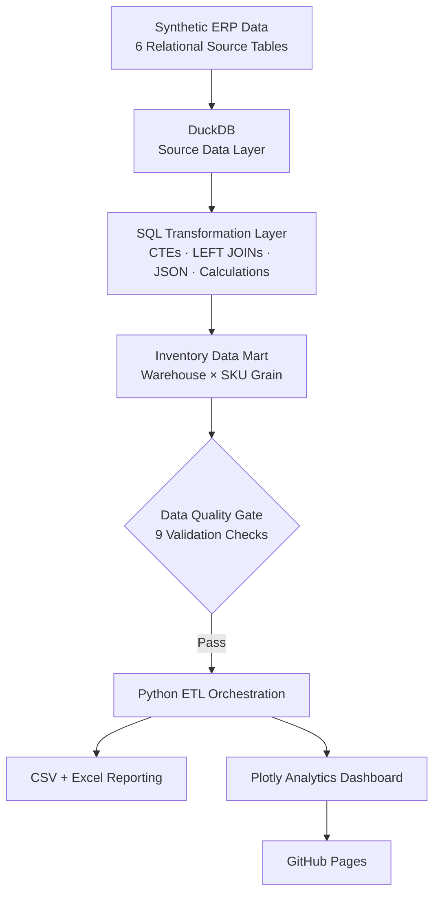

# ERP Inventory Intelligence | SQL & Data Engineering Pipeline

**A reproducible, SQL-driven ETL pipeline transforming synthetic ERP inventory data into a validated analytical data mart, automated Excel reports, and an interactive inventory dashboard.**

**[Explore Live Dashboard](https://kahanc.github.io/erp-inventory-data-pipeline/)** | **[View SQL Transformations](https://github.com/KahanC/erp-inventory-data-pipeline/blob/main/sql/03_inventory_mart.sql)** | **[Explore ETL Pipeline](https://github.com/KahanC/erp-inventory-data-pipeline/blob/main/src/pipeline.py)**

`SQL` · `DuckDB` · `Python` · `ETL` · `Data Modeling` · `Data Quality` · `Plotly` · `Excel`

---

## Overview

An end-to-end inventory data engineering system inspired by an ERP-integrated manufacturing reporting workflow.

The pipeline extracts synthetic ERP-style records from six relational datasets, executes advanced SQL transformations, validates data integrity, and produces analytics-ready inventory reports.

Designed to demonstrate practical SQL engineering, relational data modeling, ETL orchestration, and automated data quality assurance.

### Project at a Glance

| Metric | Implementation |
|---|---|
| Source tables | 6 relational ERP datasets |
| Inventory records | 600 warehouse–SKU combinations |
| Data transformation | Multi-table SQL joins, CTEs, JSON extraction |
| Analytical model | Warehouse–SKU inventory mart |
| Data validation | 9 quality checks + 4 integration tests |
| Output formats | DuckDB, CSV, Excel, interactive HTML |
| Execution | Single-command Python ETL pipeline |

All data is synthetic. No proprietary records, credentials, or live ERP connections are included.

## System Architecture



## SQL Engineering

The core transformation consolidates six ERP-style tables into a unified inventory dataset.

**Key techniques:**

- Multi-table `LEFT JOIN` operations across inventory and reference datasets
- Common Table Expressions (CTEs) for modular SQL transformations
- JSON extraction for custom product attributes
- Array and price-field parsing
- Calculated inventory valuation and availability metrics
- Warehouse–SKU grain enforcement to prevent duplicate inventory records

**Core SQL:** [`sql/03_inventory_mart.sql`](sql/03_inventory_mart.sql)

### Analytical Inventory Mart

The transformation produces warehouse-level SKU records containing:

| Category | Derived information |
|---|---|
| Inventory availability | On-hand, committed, backordered, available and projected stock |
| Inventory valuation | Average cost and extended inventory value |
| Replenishment | Reorder-point gaps and below-threshold indicators |
| Product attributes | Product classification and custom ERP fields |
| Warehouse analytics | Warehouse-level inventory aggregation |

## Automated ETL Pipeline

The Python pipeline orchestrates the complete data workflow:

1. Generate synthetic ERP source records.
2. Load relational datasets into DuckDB.
3. Execute SQL transformations to build the inventory mart.
4. Validate source-to-mart consistency and data quality.
5. Export structured CSV and formatted Excel reports.
6. Generate an interactive Plotly dashboard.

**Pipeline implementation:** [`src/pipeline.py`](src/pipeline.py)

### Data Quality & Validation

Nine automated checks verify the integrity of transformed inventory data, including:

- Source-to-mart row reconciliation
- Duplicate warehouse–SKU detection
- Reference table join integrity
- Missing cost and pricing checks
- Inventory valuation consistency

Four additional integration tests verify the pipeline and generated outputs.

Validation failures stop downstream reporting, preventing invalid datasets from being published by the pipeline.

## Interactive Inventory Dashboard

**[Launch Dashboard](https://kahanc.github.io/erp-inventory-data-pipeline/)**

The dashboard visualizes the validated inventory mart through:

- Total inventory valuation and warehouse–SKU coverage
- Below-reorder-point and negative-availability indicators
- Warehouse and product-group comparisons
- Inventory status distributions
- Replenishment risk monitoring

Charts are generated from SQL-based aggregations and exported as standalone interactive HTML.

GitHub Pages hosts the pre-generated dashboard; it does not execute Python or SQL in real time.

## Run Locally

### Prerequisites

Python 3.10+ and pip. No Docker or database server required.

```bash
git clone https://github.com/KahanC/erp-inventory-data-pipeline.git
cd erp-inventory-data-pipeline

python3 -m venv .venv
source .venv/bin/activate

python -m pip install -r requirements.txt
```

### Execute the Pipeline

```bash
python src/pipeline.py
```

### Run Integration Tests

```bash
python -m unittest discover -s tests -v
```

### Open the Dashboard

```bash
open docs/index.html
```

The pipeline generates a persistent local DuckDB database, CSV and Excel reports, execution logs, and an interactive HTML dashboard.

## Repository Structure

```text
erp-inventory-data-pipeline/
├── data/                  # Synthetic ERP source data
├── sql/                   # Schema, transformations, quality SQL
├── src/
│   ├── generate_data.py   # Synthetic ERP data generator
│   ├── load_duckdb.py     # Source ingestion
│   ├── build_mart.py      # SQL transformation execution
│   ├── validate.py        # Data quality checks
│   ├── export.py          # Excel and CSV reporting
│   ├── dashboard.py       # Plotly visualization
│   └── pipeline.py        # ETL orchestration
├── tests/                 # Integration tests
├── docs/
│   └── index.html         # GitHub Pages dashboard
├── requirements.txt
└── README.md
```

## Engineering Considerations

**Data grain:** Inventory is modeled at the warehouse–SKU level, supporting consistent inventory reconciliation and aggregation.

**Reproducibility:** Synthetic source generation and local DuckDB execution eliminate dependencies on private ERP infrastructure.

**Reliability:** Data quality checks run before report generation, with pipeline logging and integration tests supporting troubleshooting.

**Portability:** The pipeline requires Python packages rather than Docker or a separately managed database server.

## Scope & Limitations

This repository is a synthetic reconstruction of an ERP inventory reporting workflow, not a production Spire integration.

The implementation uses local batch processing rather than real-time API ingestion. Replenishment indicators are analytical flags, not automated purchasing decisions.

---

**Built with Python, DuckDB, SQL, Plotly, and openpyxl.**
